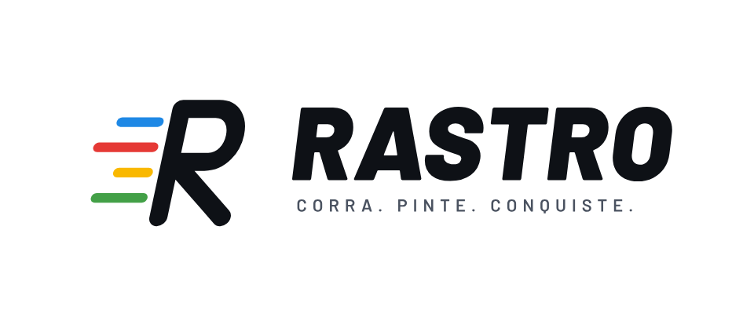

# Rastro — corra, pinte, conquiste

Jogo de GPS para corrida, caminhada e pedalada. Cada jogador entra em um dos **4 times** (vermelho, amarelo, azul e verde). Ao contornar uma área e voltar ao ponto de partida, tudo o que ficou dentro do percurso é pintado com a cor do time.

Começo regional: Palhoça e Grande Florianópolis (SC).

## Regras do protótipo

| Regra | Valor atual |
|---|---|
| Fechar o circuito | voltar a até **30 m** do ponto de partida |
| Percurso mínimo | 120 m |
| Área máxima por circuito | **8 km²** (cabe um circuito de 10 km) |
| Preenchimento ao vivo | durante a corrida a área já aparece pintada e as rivais vão sumindo; só conta ao fechar a volta |
| Roubo de área | o time toma **só a parte que contornou** das áreas rivais |
| Antitrapaça | acima de **25 km/h** a volta é anulada |
| Expiração | a área some depois de **7 dias** se o time não passar por lá de novo |

Para mudar os valores, edite o bloco `RULES` no começo do script em `index.html`.

## Como testar

O jogo é um arquivo só (`index.html`). Para o GPS funcionar, a página precisa estar em um endereço **https**:

1. No GitHub, abra **Settings → Pages**.
2. Em **Branch**, escolha `main` e a pasta `/ (root)` e salve.
3. Em 1 ou 2 minutos o jogo fica em `https://ziddeira.github.io/rastro/`.
4. Abra esse endereço no celular e permita a localização.

O **modo simulação** permite testar sem sair de casa: toque no mapa para "andar", troque de time para simular rivais e adiante o relógio para ver as áreas expirarem.

> Limitação atual: o território fica salvo só no aparelho de quem joga. O multiplayer (todos vendo o mesmo mapa) é o próximo passo, com servidor compartilhado.

## Marca

Arquivos em [`marca/`](marca):

| Arquivo | Uso |
|---|---|
| `logo-claro.svg` / `.png` | logo principal, fundo claro |
| `logo-escuro.svg` / `.png` | logo em fundo escuro |
| `logo-transparente.svg` | logo sem fundo, para fundo claro |
| `simbolo.svg` / `simbolo-branco.svg` | só o "R" com os rastros |
| `icone.svg` / `.png` | ícone com cantos arredondados |
| `icone-loja.svg` / `.png` | ícone quadrado 1024×1024 para App Store e Google Play |

As letras da logo já estão convertidas em desenho, então os arquivos não dependem de fonte instalada.

**Cores dos times**

| Time | Fundo claro | Fundo escuro |
|---|---|---|
| Azul | `#1E88E5` | `#42A5F5` |
| Vermelho | `#E53935` | `#EF5350` |
| Amarelo | `#F9B800` | `#FFCA28` |
| Verde | `#43A047` | `#66BB6A` |

Tinta: `#0E1116`. Fonte: Barlow (Black Italic no nome, SemiBold na frase).
